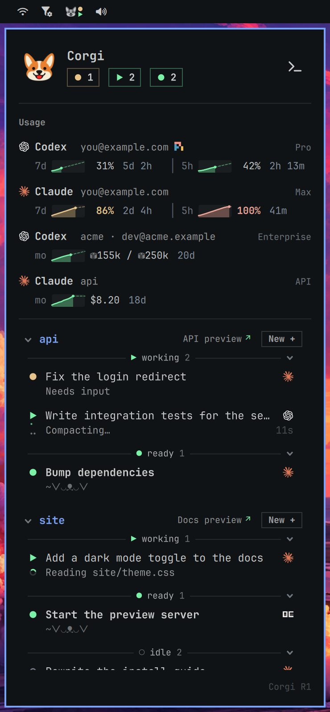

# Corgi for Omarchy <picture><source media="(prefers-color-scheme: dark)" srcset="https://raw.githubusercontent.com/tals/corgi-omarchy/main/assets/corgi-omarchy-dark.svg"></picture>

[Corgi](https://corgi.computer) plugin for [Omarchy](https://omarchy.org).

## Install

```sh
omarchy plugin add https://github.com/tals/corgi-omarchy --enable
```




## Development

See [HACKING.md](HACKING.md).

## License

Released under the [MIT License](LICENSE).
